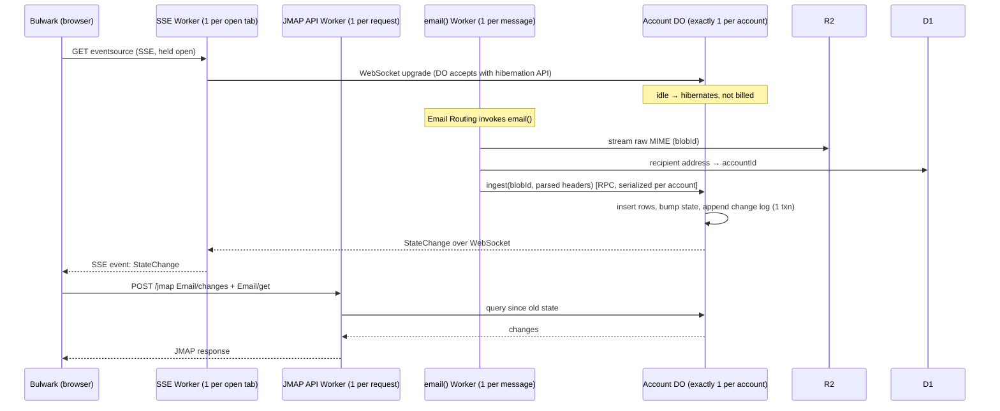

# Follow-up research: auth, Durable Objects, shared mailboxes, webmail, spam

Date: 2026-10-12. Follows `2026-10-initial-research.md`. Status: research. Decisions that came out of it are recorded in `README.md`, `docs/` and the module READMEs.

✅ = re-checked against primary source or code in-session. Everything else is from Haiku research passes; verify before relying on it.

---

## 1. Better Auth: how much it covers

Latest `better-auth` / `@better-auth/oauth-provider` is **1.7.7** ✅. The older `oidcProvider` plugin was removed in 1.7. Better Auth is **API and client SDK only. It ships no UI.**

| Need | Better Auth piece | We build UI? | Notes |
|---|---|---|---|
| Sign-in with email + password | core `emailAndPassword` | yes: login page | |
| No public signup | `emailAndPassword.disableSignUp` ✅ (in `@better-auth/core` types) | — | Also exists on the OAuth provider options ✅ |
| Password reset | core `requestPasswordReset` / `resetPassword` + our `sendResetPassword` callback | yes: reset page | Email goes out through our sending provider. Token expiry: check. |
| Change password | core client API | yes: account page | |
| Admin: create / ban / remove users, set password, roles, impersonate, revoke sessions | `admin()` plugin | yes: admin console | `removeUser` is a hard delete. |
| 2FA (TOTP, backup codes, trusted device) | `twoFactor()` | yes: enrol + challenge | 1.7 changed the `enableTwoFactor` response shape. |
| Passkeys | `@better-auth/passkey` | yes | optional |
| Sessions list / revoke | core client | yes: account page | |
| **OIDC provider (SSO)** | `@better-auth/oauth-provider` + `jwt()` | **yes: login + consent pages** (select-account optional) | Auth code + PKCE, refresh, `/.well-known/openid-configuration`, userinfo, introspect, register, JWKS. First-party clients via `adminCreateOAuthClient` with `skip_consent`. Access tokens are **JWT by default** (EdDSA), or opaque + introspection. RFC 8707 `resource` → `aud`. |
| **App passwords for native JMAP clients (Basic auth)** | `@better-auth/api-key` | yes: key management page | Default header `x-api-key`. `customAPIKeyGetter(ctx)` can extract the key from `Authorization: Basic` (UNVERIFIED). Fallback: a tiny Basic→apiKey shim in our JMAP middleware. |
| Rate limiting | core `rateLimit` with KV secondary storage | — | KV minimum TTL is 60 s: use windows ≥ 60 s. |
| Org/teams | `organization()` | — | **Not** a fit for shared-mailbox ACLs. Members must be users. Keep mailbox grants in our own tables. |

### What we build ourselves
- **Frontend:** login, consent, forgot/reset password, account (password, 2FA, sessions, app passwords), and admin console (users).
  - No usable ready-made kit. `better-auth-ui` (MIT, React + shadcn, ~1.7k★) needs TanStack Query, and SPA/Vite support is undocumented. Use it as a component source, not a dependency.
  - Consent page: 1.7.7 added `verifyOAuthQueryParams` for the signed query. We still must check client, session and scopes.
- **JMAP resource-server auth:** verify Better Auth JWT access tokens via JWKS (`iss`, `aud`, `exp`, scope), plus Basic/app-password via api-key.
  - Risk: issue #10888 reports a self-fetch of JWKS failing when the AS and RS are the same Worker. Load keys directly or use a service binding instead of an HTTP self-fetch.

### Running on Workers
- Requires `nodejs_compat` (AsyncLocalStorage, `node:crypto`).
- Build the auth instance **per request**, because bindings are request-scoped. Don't wrap the same D1 binding in two instances.
- Migrations: `@better-auth/cli generate` → Drizzle → `wrangler d1 migrations apply`. `auth migrate` cannot reach D1.
- D1 has no interactive transactions. Better Auth uses `batch()`. The SCIM flow is unsupported on D1. Test sign-up, 2FA and OAuth paths on D1 early.

### Password hashing on Workers: what Better Auth does ✅
- **No special Workers recipe; keep the default.**
- Since PR #8685 (merged 2026-04-01), Better Auth hashes via `@better-auth/utils/password`. Verified in `@better-auth/utils` 0.5.0 `package.json`: the `workerd` export condition resolves to `password.node.mjs`, which uses **native `node:crypto` scrypt (N=16384)**. Other runtimes get a pure-JS fallback.
- Requirements: `nodejs_compat`, and a bundler that honours the `workerd` condition. Wrangler does; **check the built bundle**.
- Cost reported at ~70–170 ms CPU per hash (UNVERIFIED). That rules out Workers Free (10 ms) but is fine on Paid (30 s default).
- Docs' `@node-rs/argon2` example is a native addon and **won't run on Workers**.
- If hashing CPU becomes a problem: a dedicated hasher Worker behind a service binding (e.g. `imjlk/cloudflare-auth-hasher-template`, Argon2id via Wasm).
- App-password and API-key verification must stay cheap: high-entropy random keys, so a fast hash suffices.

---

## 2. Durable Objects pricing (Workers Paid)

| Item | Included / month | Overage |
|---|---|---|
| Requests (HTTP, RPC, alarms; incoming WS msgs at 20:1) | 1M | $0.15 / M |
| Duration (128 MB billed per object) | 400k GB-s | $12.50 / M GB-s |
| SQLite rows read | 25B | $0.001 / M |
| SQLite rows written | 50M | $1.00 / M |
| SQLite storage | 5 GB-mo | $0.20 / GB-mo |

For comparison: D1 has the same row pricing (storage $0.75/GB-mo). R2 is $0.015/GB-mo with free egress. Source: [DO pricing](https://developers.cloudflare.com/durable-objects/platform/pricing/).

**Duration billing:**
- Billed while the object runs code, or sits idle but *not eligible to hibernate*. The eligibility rule: no pending request/I/O/timers.
- An **open SSE response is a pending request**, so it keeps the object billed the whole time (inferred, UNVERIFIED; measure).
- **Hibernatable WebSockets** (DO as server) are not billed while idle.
- Polling more often than every ~10 s also keeps the object awake.

**Estimate, 20 users** (100 mails/user/day, 2,000 JMAP req/user/day, connected 10 h/day):

| Push strategy | ≈ monthly |
|---|---|
| SSE held open inside the user's DO | **~$34** (≈ $29 of duration) |
| Hibernatable WebSocket into the DO | ~$5 (Workers Paid minimum) |
| Polling, gaps ≥ 10 s | ~$5 |
| Storage, year 1 (R2 raw ~37 GB + DO SQLite ~7–18 GB) | +$1–3 |

**Bulwark uses SSE (`eventSourceUrl`), not WebSocket** ✅ (`s8s-mail-webmail/lib/jmap/client.ts:8585-8655`).
- It opens the URL with `types=*`, `closeafter=no`, `ping=30`, and treats a 90 s ping gap as dead.
- **Without `eventSourceUrl` it polls every 3 s.** That is worse: a request every 3 s per open tab, and under DO-per-account it keeps the DO awake just as much as SSE does.
- Shared (non-primary) accounts are always polled every 20 s, even with SSE, because Stalwart only pushes the primary account.

**SSE is core JMAP** (RFC 8620 §7.3):
- The session advertises `eventSourceUrl` (template with `types`, `closeafter`, `ping`). The server streams `StateChange` events (`{accountId: {Email: "<state>", ...}}`); the client then calls `Foo/changes`.
- Alternatives in the spec family: Web Push (`PushSubscription`, RFC 8620 §7.2) and JMAP over WebSocket (RFC 8887). Bulwark uses neither for mail.

**Push cost is not caused by DOs as such**, but by *where the open connection is held*. Workers bill CPU, not wall-clock, so a Worker idling on an open stream is ~free. The hard part is how the Worker learns about new mail, since Workers can't notify each other:

| Storage | Push design | Latency | Cost (20 users) |
|---|---|---|---|
| D1 shared | Worker holds SSE, re-reads the account's state row from D1 every N s | N s | ~free (≈4M tiny queries/mo at N=5, within included rows + CPU) |
| D1 shared + one notifier DO | Worker holds SSE, subscribed to a DO via hibernatable WS; ingest pokes the DO | instant | ~free |
| DO per account | Worker holds SSE, subscribed to the account DO via hibernatable WS | instant | ~free |
| DO per account | SSE held *inside* the DO | instant | ~$34/mo ← avoid |

Keep pings under ~100 s so idle streams aren't cut by proxies. Bulwark asks for 30 s.

Idea to avoid the duration cost under DO-per-account (UNVERIFIED, prototype it):
- Terminate SSE in the stateless Worker. Workers bill CPU, not wall-clock.
- That Worker subscribes to the account DO over a WebSocket the DO accepts with the hibernation API.
- The DO pushes `StateChange` events and hibernates between them.

### Can it run on Workers Free (with Mailgun for sending)? ✅ limits checked 2026-10-12

Workers Paid is **$5/month per account**, not per user. It covers every Worker on the account and includes 3,000 Cloudflare-sent emails/month. Dropping Cloudflare sending in favour of Mailgun does **not** remove the need for Paid.

The blocker is the **10 ms CPU per invocation** on Free. It applies to `fetch()` and `email()` alike ([Workers limits](https://developers.cloudflare.com/workers/platform/limits/)). These operations exceed it:
- **Password login:** scrypt costs ~70–170 ms per hash.
- **Parsing incoming mail with attachments:** a multi-MB MIME message. If `email()` fails, the message bounces or is lost.
- **Building outgoing MIME** with base64 attachments.

Other Free limits, workable for 1–5 users:

| Resource | Free limit |
|---|---|
| Worker requests | 100k / day |
| Subrequests | 50 per invocation |
| D1 rows read | 5M / day |
| D1 rows written | 100k / day |
| D1 per database | 500 MB |
| DO storage | 5 GB per account |
| DO classes | 100 |

SQLite DOs are available on Free.

~~Untested possibility: DOs on Free might get 30 s CPU.~~ **Ruled out** ✅. The DO FAQ ([source](https://github.com/cloudflare/cloudflare-docs/blob/production/src/content/partials/durable-objects/do-faq-limits.mdx)) says DOs "have the same per invocation CPU limits as any Workers do". The FAQ also gives DO SQLite storage as 1 GB per object on Free.

#### Password hashing on Workers: documented evidence (researched 2026-10-12)

**Hard blockers:**
- **WebCrypto PBKDF2 is capped at 100,000 iterations in production, on every plan** ✅.
  - Error: `Pbkdf2 failed: iteration counts above 100000 are not supported`.
  - [workerd#1346](https://github.com/cloudflare/workerd/issues/1346), still open. kentonv: the cap exists because CPU limiting "cannot interrupt BoringSSL in the middle of running PBKDF". jasnell (2024-01): configurable in open-source workerd, but "in the production environment the current limit will remain".
  - OWASP recommends 600k for PBKDF2-HMAC-SHA256, so **PBKDF2 can't reach recommended strength on Workers. Don't use it.** A PR to raise the cap to 1M ([workerd#7550](https://github.com/cloudflare/workerd/pull/7550)) is open and unmerged.
  - Also hit in the wild: [payloadcms#18274](https://github.com/payloadcms/payload/issues/18274).
- **Free plan, 10 ms:** no report of a recommended-strength hash fitting.
  - Better Auth 1.7.6 default scrypt, deployed: 73–170 ms per hash ([blog, 2026-09](https://nilaykabariya.blog/deploy/worker-exceeded-cpu-time-limit-error-1102)).
  - PBKDF2 210k ≈ 95 ms; 100k ≈ 23 ms.
  - Lucia v2 docs stated outright that password hashing doesn't work on Free.
- **Native crypto counts as CPU time.** It runs inside the isolate lock and can't be interrupted, per kentonv's explanation above. Service-binding a "hasher Worker" does not give a fresh budget either: CPU is summed across bound Workers (pricing page; Free behaviour UNVERIFIED).

**Soft issues:**
- Cloudflare allows an undocumented burst ("some built-in flexibility … if your Worker starts hitting the limit consistently, its execution will be terminated").
- One reported run under a 10 ms limit: the first 10 hashes passed, then 6 of 20 failed. So Free *appears* to work in light testing, then fails intermittently.
- Better Auth [#8860](https://github.com/better-auth/better-auth/issues/8860) (pure-JS scrypt, intermittent CPU failures) was fixed by [#8685](https://github.com/better-auth/better-auth/pull/8685), which switched to native `node:crypto` scrypt.
- Better Auth [#969](https://github.com/better-auth/better-auth/issues/969): ~4.5 s CPU sign-ins on older pure-JS versions.

**What works:**
- **Paid:** native `node:crypto` scrypt, Better Auth's current default. Cloudflare's Node crypto docs list scrypt as supported and argon2 as *not* supported. Tens to ~170 ms per hash, well within 30 s.
- Argon2id via Rust/WASM in a hasher Worker is an alternative. No Workers timings found.
- **Free (if ever needed):** avoid password hashing entirely.
  - Passkeys: WebAuthn signature verification is cheap.
  - Email OTP / magic link, or OAuth to an external IdP.
  - App passwords are random high-entropy keys, so a fast hash is fine.
  - Large-MIME parsing would still be a problem on Free.

Conclusion: plan for Workers Paid. A Free-tier mode would mean text-only mail, passkey/OAuth-only login, and the untested DO CPU behaviour above.

## 3. Self-hosting if we leave Cloudflare

- **workerd** (Apache-2.0) can run DOs with SQLite on `localDisk`. That mode is marked **EXPERIMENTAL; subject to backwards-incompatible change**.
  - Single node, no backups/PITR, "not a hardened sandbox".
  - No D1 binding.
  - No Email Routing equivalent: you need an SMTP ingress such as Haraka or Postfix → HTTP.
  - Viable for hobby use, not a production story.
- **DO-like self-hostable runtimes:** Rivet actors (Apache-2.0, SQLite per actor, young) and Deno `celld` (Apache-2.0, alpha).
- **Realistic portability path:** keep business logic behind interfaces and write adapters per platform.

  | Interface | Cloudflare adapter | Self-host adapter |
  |---|---|---|
  | `AccountStore` (exec, transaction, `changesSince(modseq)`, single writer per account) | DO SQLite | one SQLite file per account, owned by one process |
  | `BlobStore` | R2 | S3/MinIO/filesystem |
  | `Directory` | D1 | SQLite/Postgres |
  | Mail ingress | Email Routing | SMTP server |
  | Mail sending | already provider-abstracted | already provider-abstracted |

  Keep alarms, hibernation and Email-Worker specifics in adapters. Precedent: Stalwart splits storage into data/blob/search/in-memory roles.
- Note: **mail ingress and sending are bigger lock-in than DOs.** Leaving Cloudflare means adding an MTA regardless of the storage choice.

---

## 4. Shared mailboxes: how others do it

| Provider | Model | UX |
|---|---|---|
| Google Workspace | **Delegation**: delegate gets the whole account (read/send/delete, ≤1,000 delegates). **Collaborative Inbox** in Google Groups: assign conversations, mark resolved. | Delegate switches into the other account in Gmail (separate tab). Collaborative Inbox lives in the Groups UI, not Gmail. |
| Microsoft 365 | **Shared mailbox** = its own unlicensed mailbox. Users get *Full Access* and *Send As* / *Send on Behalf*. | **Auto-mapped into Outlook's folder tree** under the user's own mailbox. Sent mail can land in the shared mailbox's Sent. |
| Fastmail | **Per-folder sharing** (view / change / change+share). Quota counts against the owner. Read state shared or per-user, set by the owner. | Shared folders appear under the owner's account in the folder list. |
| Proton | Groups are just distribution lists. | No shared inbox. |

**JMAP model:**
- RFC 8620 `isPersonal: false` accounts and RFC 9670 Principals (`principals:owner`) support "**shared mailbox = its own account**" (the M365 model).
- Per-folder `Mailbox.shareWith` / `myRights` is the Fastmail model, from `draft-ietf-jmap-mail-sharing`, which expired 2026-06.

**Fit with one-DO-per-account:**
- **Shared mailbox as its own account → its own DO.** Fits naturally: own quota, state and change log. Members get grant rows in D1. No cross-DB queries.
- Per-folder sharing across accounts means routing members into the owner's DO and enforcing ACLs per query. It's possible, but the owner's offboarding breaks it.
- **Bulwark already supports this** ✅. `getAllMailboxesWithState` loads mailboxes from **every account in the session** and marks non-primary ones `isShared` (`s8s-mail-webmail/lib/jmap/client.ts:1703-1755`). The settings "Shared with me" list uses `isPersonal` (`client.ts:5420`).
- `$seen` is per-Email, so it's shared by default in a shared account (like Cyrus `sharedseen`). Per-user read state needs an overlay table keyed by (principal, emailId).
- Assignment / "resolved" (Google Collaborative Inbox) would be a custom extension. Not a JMAP primitive.

---

## 5. Webmail options

| Client | License | Stack / deploy | SSO with our IdP | Verdict |
|---|---|---|---|---|
| **Bulwark Lite** (current) | AGPL-3.0 | Next.js static export → Workers Static Assets | **Only after a patch** (below) | Most complete UI; best option with a patch |
| Bulwark full | AGPL-3.0 | Node server with fs state | generic OIDC works | Not Workers-friendly |
| root-fr/jmap-webmail | MIT | Next.js server | generic OIDC | **Bulwark's own MIT ancestor** ✅ (Bulwark `NOTICE`): same architecture, older, "built for Stalwart". Not a real alternative. |
| thunderbird/stormbox | MPL-2.0 | Vue 3 static + Cloudflare Worker bridge | Keycloak OIDC + PKCE | Closest architecture, actively pushed (2026-10-12 ✅), but self-described experiment. Watch. |
| linagora/tmail-flutter (Twake Mail) | AGPL-3.0 | Flutter web, static | web OIDC config exists | Mature but heavy, TMail/James-coupled |
| Cypht, Roundcube, SnappyMail | — | PHP | — | IMAP-centric / server needed: no |
| Build our own (on `jmap-jam`) | ours | Vite static | exact fit | ~4–8 eng-weeks for an MVP, months for polish. HTML sanitising, caching and offline are the hard parts. |

No shipping Thunderbird JMAP yet: desktop has no commitment, iOS/Android are exploring. Stalwart's own webmail is not shipped.

### Bulwark Lite generic-OIDC patch: scope ✅ (read in code)
- OAuth is gated by `LITE_OAUTH_AVAILABLE = IS_LITE_STALWART` (`s8s-mail-webmail/lib/auth/lite-oauth.ts:28`). It is used in `app/(main)/[locale]/login/page.tsx` and `app/(main)/[locale]/auth/callback/page.tsx`.
- Changes needed:
  1. Enable it for the `static` target.
  2. Read the client ID from `config.json` instead of the Stalwart-injected global (`s8s-mail-webmail/lib/lite.ts:77`).
  3. Use standard `.well-known` discovery (`s8s-mail-webmail/lib/oauth/discovery.ts` already does this) instead of Stalwart's `GET /api/discover/<account>`.
  4. Make the `/oauth/callback` route work under static hosting.
- The refresh path already accepts a discovered `tokenEndpoint` (`s8s-mail-webmail/lib/auth/lite-tokens.ts:471`).
- Estimate: a moderate, frontend-only change (~4–5 files). A good **upstream PR candidate**, which avoids carrying a fork.

---

## 6. Spam / Cloudflare Email Security

- **Cloudflare Email Security** (ex-Area 1) targets M365 / Google Workspace, in API, BCC or MX-inline modes.
  - **Sales-led** ("Contact sales"), no published self-serve price. Fails our "publicly available, self-serve" rule.
  - MX-inline mode conflicts with Email Routing's MX records; chaining them is undocumented.
  - **Not an option.**
- **What Email Routing already does inbound** ([postmaster](https://developers.cloudflare.com/email-routing/postmaster/)):
  - Rejects mail failing both SPF and DKIM.
  - Rejects mail failing the sender's DMARC policy.
  - Rejects RBL-listed senders (554).
  - Adds `ARC-Authentication-Results`. Whether `Authentication-Results` / `X-CF-SpamH-Score` reach `message.headers` is UNVERIFIED: log real messages to check.
- **Later DIY options:**
  - Rule-based score, flag rather than reject.
  - Bayesian filter with token counts in DO/KV. `hugoh/cf-spam-gate` (GPL, archived) is a reference.
  - Spamhaus DQS (needs a key; public resolvers are refused).
  - Workers AI LLM classification.

---

## 7a. Auth / account / admin frontend: placement (recommendation)

**SPA, not SSR.**
- Every page (login, consent, reset, account, admin) is behind auth or a one-shot token. Nothing needs SEO or server rendering.
- Better Auth's OAuth provider only needs the `loginPage` / `consentPage` *URLs*. The SPA reads the signed query and calls the API.

**Repo layout** (pnpm workspace inside `s8s-mail/`, flat, no `apps/` nesting; decided, see README.md):

```
s8s-mail/
  server/   the Worker: fetch() = JMAP + Better Auth + /.well-known; email(); DO classes
            wrangler.jsonc → assets.directory = "../web/dist"
  web/      SPA: /login /consent /reset-password /account /admin
            reads runtime config.json (apiBaseUrl, issuer) → same bundle works bundled or headless
  shared/   API contract types / schemas shared by both
  docs/
```

**Bundled mode (default).** One Worker serves the SPA via Workers Static Assets plus the API:

```jsonc
"assets": {
  "directory": "../web/dist",
  "binding": "ASSETS",
  "not_found_handling": "single-page-application",
  "run_worker_first": ["/api/*", "/jmap/*", "/.well-known/*"]
}
```

Gotcha ✅ ([docs](https://developers.cloudflare.com/workers/static-assets/routing/single-page-application/)):
- In SPA mode, **browser navigations** (`Sec-Fetch-Mode: navigate`) are answered with `index.html` *without invoking the Worker*. `run_worker_first` takes precedence over this.
- So every path a browser *navigates* to must be listed. That covers the OAuth `/authorize` redirect (Better Auth default base path `/api/auth/...`), `/.well-known/openid-configuration`, and attachment downloads opened in a new tab (`/jmap/download/...`).

**Headless mode.** Deploy the server without `assets`, and host `web/dist` anywhere with a `config.json` pointing at the API.
- Better Auth: set `trustedOrigins`, CORS, and the absolute `loginPage` / `consentPage` URLs to the SPA's origin.
- **Cookie constraint:** the session cookie belongs to the API host. If the SPA is on a *different site*, the cookie becomes a third-party cookie, which Safari and Firefox block by default.
- So headless deployments should put the SPA on a **subdomain of the same registrable domain** (`account.example.com` + `mail.example.com`). That is same-site, so cookies with `SameSite=Lax` work with `credentials: "include"`. Optionally use Better Auth `crossSubDomainCookies`.

## 7b. Inbound mail and push flow (per-account DO design)



**How many of each:**
- Stateless Workers (`email()`, SSE, API) are the *same script* running as many parallel invocations anywhere.
- The account DO is a single instance per account. Every write for that account is serialized through it.
- D1 is one database. R2 is one bucket.

## 7c. Durable Object count, D1-only, and Queues

**Two candidate designs, not to be confused:**

| | A. D1-centric | B. DO per account (recommended) |
|---|---|---|
| Mail metadata, state, change log, FTS | one shared D1 (rows tagged `account_id`) | each account's DO SQLite |
| D1 holds | everything | directory + auth only |
| DO used for | push notifications only | mail store **and** push |

**How many notifier DOs (design A)?**
- **DOs have no per-object cost.** You pay for requests, active duration and storage. An idle DO costs nothing.
- One per account therefore costs the same as one global DO, and it avoids a hotspot.
- One global DO also works at org scale (soft limit 1,000 req/s per object ✅), but every push and every open stream funnels through one instance in one location.
- Middle ground: shard by `hash(accountId) % N`. Notifier DOs hold no durable data, so re-sharding just means clients reconnect.
- Recommendation: per-account, keyed by `idFromName(accountId)`. Routing is simplest, and it's the same object design B would use.

**Why not Queues for push?**
- Cloudflare Queues deliver messages to a consumer **Worker invocation** in batches, with retries.
- A queue cannot reach the specific Worker invocations holding a user's open SSE streams: there is no pub/sub fan-out to connections. Batching also adds delay.
- Something has to *hold* the connections and know who is listening. On Cloudflare, that's a DO.
- Queues are the right tool elsewhere:
  - outbound sending with retries/backoff (provider 429/5xx);
  - Mailgun webhook processing;
  - optionally decoupling `email()` from ingest, so a failed DB write is retried instead of bounced.

**Why design A is risky: D1 limits** ✅ ([D1 limits](https://developers.cloudflare.com/d1/platform/limits/)):
- **Hard 10 GB per database ("cannot be further increased").**
  - With FTS over bodies, metadata runs ~10–25 KB/email.
  - 20 users × 100 mails/day ≈ 7–18 GB/year. A single shared D1 could hit the cap in about a year under that (heavy) assumption.
  - Fix: shard across several D1s (per account or per group), which is design B with more plumbing.
- **Single-threaded per database:** queries run one at a time, so ~1,000 qps at 1 ms/query, shared by *all* users' ingest + JMAP reads.
- No interactive transactions. Only `batch()` is atomic, so "read state, decide, write" logic must be expressed as single SQL statements.
- Cloudflare's own guidance: D1 is "designed for horizontal scale out across multiple, smaller (10 GB) databases, such as per-user, per-tenant".

So design B removes the size cap problem (10 GB *per account*), serializes writes per account rather than globally, and gives real transactions inside the DO. D1 stays small: users, domains, address routing, auth.

## 7d. Lint / format: Biome vs oxlint + oxfmt

Versions checked on npm 2026-10-12 ✅: Biome 2.5.15, oxlint 1.87.0, oxfmt 0.72.0.

| | Biome 2.5 | oxlint 1.x + oxfmt 0.x |
|---|---|---|
| Status | One tool, stable 2.x since 2025-06 | oxlint stable since 2025-06. **oxfmt still pre-1.0** (beta since 2026-02) |
| Lint rules | 500+ | ~870 (ESLint, typescript-eslint, react, jsx-a11y, import, unicorn, vitest) |
| Type-aware lint | Own inference: `noFloatingPromises`, import cycles, etc. Fewer rules | tsgolint: 59/61 typescript-eslint type-aware rules. Needs TypeScript 7 (tsgo) |
| Custom rules | GritQL plugins | JS plugins (ESLint API), alpha |
| Formatter languages | JS/TS/JSX, JSON, CSS, GraphQL (HTML experimental) | JS/TS, JSON, YAML, TOML, CSS, Markdown, HTML, … |
| Tailwind class sorting | `useSortedClasses`: nursery, partial | Built into oxfmt |
| Tailwind v4 CSS | Needs `css.parser.tailwindDirectives`. Open parser bugs (#12179) | Unverified |
| Speed | Fast | Faster (vendor benchmarks) |

**Decided: oxlint + oxfmt.**

Trade-off: Biome is one stable tool, but weaker on Tailwind v4 CSS and has fewer rules. Oxc has more rules, full type-aware parity and better Tailwind sorting, but uses two tools and a pre-1.0 formatter.

## 7. Remaining open decisions

- [x] Storage: **design B, one DO per account** (CLAUDE.md). The self-hosting concern is answered above: portable via an `AccountStore` interface.
- [x] Webmail: **patched Bulwark Lite**, fork at `wtarit/s8s-mail-webmail` (CLAUDE.md).
- [x] Push: SSE held by a stateless Worker, hibernatable WebSocket to the account DO (CLAUDE.md). Still measure duration billing once built.
- [x] Auth/account/admin frontend is an **SPA**, bundled with the main Worker by default and deployable headless (see CLAUDE.md).
- [x] Repo layout: flat `server/`, `web/`, `shared/` (CLAUDE.md).
- [x] Stack: Hono, Drizzle (D1 + durable-sqlite), Vite + React + shadcn/ui. Address model: multi-domain + aliases + plus-addressing (CLAUDE.md).
- [ ] Shared mailbox model (own account vs per-folder ACL). Not V1, but it affects the D1 directory schema (principals, grants).
